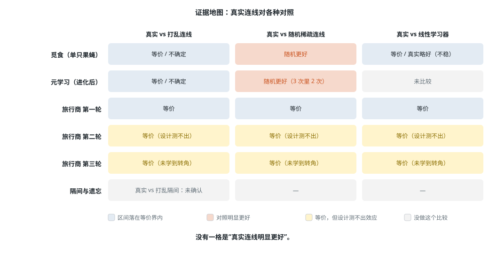
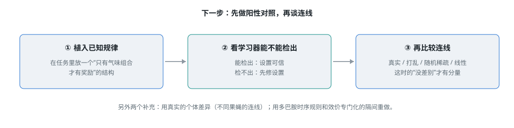

# 真实连线没测出优势：一个“负结果”项目到底留下了什么

> 《真实果蝇连接组能否当作学习与优化的归纳偏置》系列 · 第 7 篇（总结）
> 项目代码与全部实验记录：<https://github.com/meiluosi/fly-connectome-study>

这一篇回答三个问题：真实连线有没有用，结论能信多少，项目留下了什么。

## 1. 回顾：项目走过的路

起点是一个更大的问题：系统能不能改进自己的学习方式（RSI）。落到一个有真实结构的学习器上，就是果蝇蘑菇体：

1. **隔间与遗忘：** 优势主要来自“学得少”，匹配学习量后消失。
2. **持续学习审计：** FlyModel 被免回放的 SLDA 超过；论文里的稀疏优势大半来自对照本身。
3. **觅食与果蝇群：** 蘑菇体会学习，随机稀疏连线反而更好；共享信息越多越好，聚集有害。
4. **元学习：** 第一次进化只得到 +4 到 +7，因为遗忘速率的编码把起点卡在平坦处；修好起点重跑后，9 次进化全部选了遗忘，in-dist 提升到 +14 到 +21，代价是不反转的世界变差。
5. **旅行商三轮：** 在线学习、异质群体、通信、2-opt、转角上下文，收益都不超过 0.5 个百分点。

## 2. 结论：真实连线有没有用

**没有一格是“真实连线明显更好”。** 觅食和元学习里随机稀疏连线反而更好；旅行商里各种连线等价，但其中两轮的设计测不出连线效应。

- **能说：** 这些任务里，真实的 PN→KC 连线与打乱（保度数）的连线没有可测出的差别，也不优于随机稀疏连线。
- **不能说：** 真实蘑菇体的连线对计算没有意义。任务是为比较搭的玩具设定，没有效价专门化的隔间、多巴胺的时序规则、更真实的气味统计。
- **未证实的猜想：** 起作用的可能是 KC 输入强度的异质性，而不是具体拓扑。觅食里“突触数置 1”的对照给了方向性暗示，区间含 0。

最短的版本：**在这些设定下没有证据表明真实连线有帮助，其中几个设定还测不出这种差别。** 这与“已经证明没有帮助”不同。

## 3. 可信度：这些结论能信多少

| 比较可信 | 要打折扣 |
|---|---|
| 蘑菇体回路会学习，比不学习好得多（觅食 +35 到 +44） | 蚁群对果蝇群：蚂蚁要带食回巢才计分，记账不对等 |
| FlyModel 被免回放的 SLDA 超过（三个基准一致） | CIFAR 上的反向传播基线很弱，可能与宽隐层和单遍预算有关 |
| 隔间的遗忘优势主要来自学得少 | 旅行商：特征与距离相关 0.85、转角信息没学到，测不出连线效应 |
| 群体里共享信息越多越好，聚集有拥挤成本 | 异质群体只是随机缺失 30% 的 KC，不是真实的个体差异 |

## 4. 教训：四件事

协议层面的做法（阳性对照、区间说话、对照先审、独立审查、保留原结果）见第 2 篇。这里补充四条：

1. **没有阳性对照，不要写“没有效应”。** 旅行商的三轮都缺这一步。
2. **对照和基线先看绝对水平。** 稠密对照停在随机水平、基线停在随机水平，都说明比较本身有问题。
3. **表示和分类器分开比，调参、预算、数据流对齐。** 否则分不清是哪一个在起作用。
4. **优化器的搜索空间会决定结论。** 元学习里 9 次进化都没选遗忘，差点写成“遗忘没用”；手动扫描显示遗忘在波动世界里很有用，是遗忘速率的编码把起点放在了平坦处，进化走不出来；修好起点重跑后 9 次进化都选了遗忘。结论要靠直接检验，不能只看优化器的答案。

## 5. 项目的价值

- **科学贡献小：** “遗忘取决于学到多少”是持续学习的常识，“全脑 LIF 的 KC 不稀疏”已有报道，也没有做系统的文献检索，不能声称这些是新的。
- **模型是真实蘑菇体的弱代理：** “没发现效应”说明不了真实果蝇。
- **主要价值在过程和工程：** 预先登记、哈希冻结、独立审查、对被推翻结论的更正，以及可复现的流水线和交互页面。

## 6. 补充：加了阳性对照和真实气味之后

后续的 `fly-v4/` 补了上面“下一步”里的前两项，结果不改变主结论：

- **阳性对照：** 第一版的对照是循环的（教师就是学生的连线，审查指出）。改成教师连线被重排 30% 后，真实比打乱、随机稀疏高约 +0.06，说明流程检得出连线实例的作用；但教师只共享“度数与突触数分布”（统计类别）时检不出。
- **真实气味（DoOR）：** 真实气味 + 随机类别标签下，真实 ≈ 随机稀疏（−0.001，区间 [−0.006, +0.004]）。温和的无监督适应没有提高样本效率。
- **行为现象：** 5 个学习器都复现了气味重叠梯度和反转；这些由稀疏编码加误差驱动规则决定，不区分连线。真实与单位权重学习器的差别混杂了编码稳定性，不能归因到突触强度。

## 7. 下一步：该先做什么

1. **真实的个体差异：** 用不同个体（FlyWire 和 MaleCNS）的对齐连线，而不是随机缺失。
2. **回到最初的问题：** 用多巴胺的时序规则、效价专门化的隔间，重做持续学习和觅食。
3. **让特征不被已有信息重复：** 例如旅行商里，学习器要有距离和信息素之外的信息可学。

## 8. 资源：代码、流程和 skill

- 代码、预先登记、结果、审查报告：<https://github.com/meiluosi/fly-connectome-study>。
- 协议整理成了 skill，并扩展成一条从实验可信度到写作核对的完整链路：<https://github.com/meiluosi/research-writing-skills>（`preregistered-experiment`、`independent-review`、`result-writeup-editor` 等，MIT）。
- 前六篇：回路与比较框架、协议与审查、觅食与果蝇群、持续学习审计、元学习、旅行商三轮。
