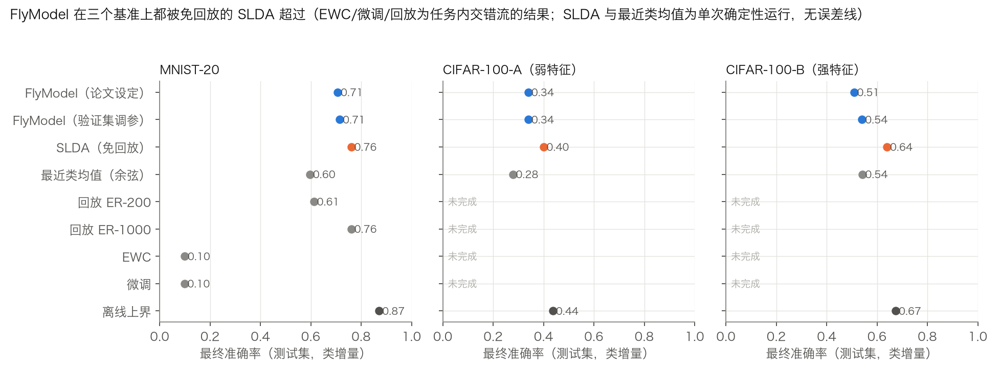
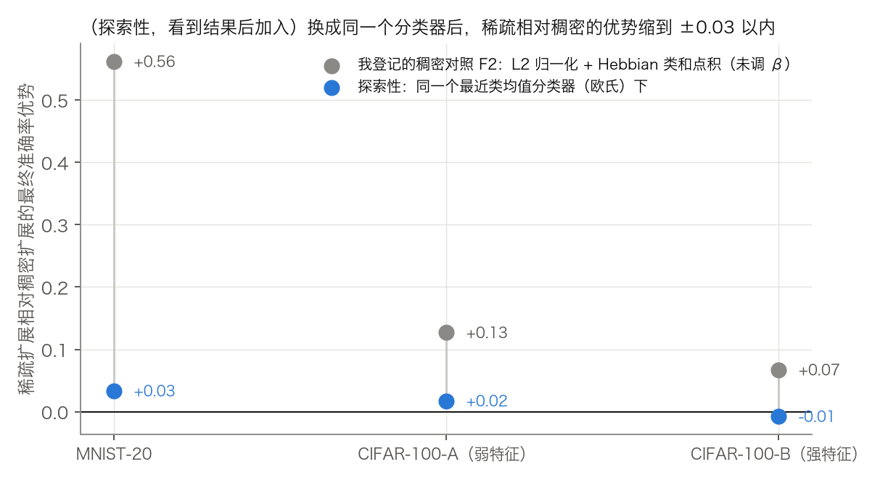

# 一个"仿果蝇"的持续学习方法被一个同样免回放、但需要估计协方差的方法超过了：对 FlyModel 的一次审计

> 所有数字来自本仓库 `ml-cl-audit/` 下的脚本与 `RESULTS_audit.md`。这篇文章只审计了**一篇论文**，结论只对文中的基准与特征成立。

**一句话版本**：FlyModel（Shen、Dasgupta、Navlakha；模仿果蝇蘑菇体）被报告在类增量学习里优于 EWC、GEM 等。我复现了它，并用预先登记的协议、独立验证集调参的基线去检验：在三个基准上它都被**同样免回放的 SLDA 超过**（SLDA 需要估计协方差，不是同样廉价的方法）；更简单的最近类均值只在强特征上追平它；和 EWC / 回放的对比**只在 MNIST-20 上完成**，CIFAR-100 因预算未完成。看到结果后我加了一个探索性对照：论文式"稠密编码失败"的对照把稀疏表示的价值夸大了很多（MNIST-20 上约 17 倍）。过程中我自己造成并更正了几个缺陷，其中最重要的是我登记的流对反向传播基线不公平。

## 先说几个词
- **类增量持续学习**：模型依次学几组新类别（任务），测试时要在见过的所有类别上分类，没有任务编号。
- **学习时准确率（A_jj）**：刚学完某任务时，在该任务类别上的准确率。**遗忘 / memory loss**：学习时准确率 − 全部学完后的准确率。
- **FlyModel**：输入经固定的稀疏随机矩阵投到更高维（MNIST-20 为 84→3200，CIFAR-100 为 512→20000），只保留激活最强的 l 个单元（k-WTA；MNIST-20 是 5%，CIFAR-100 的论文默认是 1%），再做 min-max 归一化；每个类的权重 = 该类样本特征的累加（Hebbian，学习率 β），权重截断到 [0,1]。没有反向传播。下文 **F0** = 论文默认设定，**F1** = 我在验证集上调过 l 与 β 的版本。
- **SLDA**（流式线性判别分析）与 **最近类均值（NCM）**：不用反向传播的基线，每个类只存统计量（均值；SLDA 还存共享协方差）。
- **EWC / 回放（ER）**：给重要权重加惩罚；保存少量旧样本重新训练。
- **弱特征 / 强特征**：CIFAR-100 用 ImageNet 预训练的 ResNet18 提取 512 维特征。弱特征 = 原生 32×32 输入，强特征 = 放大到 224×224。我选这两个是因为论文没写清，我的复现（0.340 与 0.508）把论文的 0.41 夹在中间。
- **类内顺序流 / 任务内交错流**：基线训练时的样本顺序。前者（我最初登记的）把一个类的所有样本连续喂入；后者把一个任务内的样本打乱。FlyModel 与顺序无关，所以这个选择只可能影响基线。

## 一个先于所有实验的观察
FlyModel 的权重只增不减，特征也非负（我核对过三套特征最小值都是 0），所以"每步截断到 1"与"累加后一次截断"完全等价，**结果与样本顺序无关**；每个类的权重只依赖该类自己的样本，本质上是随机稀疏特征上的类原型分类器。因此它在**权重空间里不覆盖旧记忆是构造性的**（NCM、SLDA 也一样；我用测试验证了打乱类顺序后结果不变）。它的 memory loss 约 0.09 并不是权重被改写，而是类别变多后决策竞争更激烈。

## 做了什么
1. **先复现**：目标数字和容差先写下并锁哈希。MNIST-20 复现成功（最终 0.707，论文约 0.75，在 0.05 容差内；memory loss 0.089 对 0.07）。**CIFAR-100 数值上没复现**，我没有去调参凑，而是把两种特征当作两个区间，**只做方法间的相对比较**（放大到 224 是看到 32×32 的结果之后才加的，属于事后调整）。
2. **预先登记协议**：同样的冻结特征与任务顺序，5 个种子（FlyModel 的随机性只在投影矩阵）；超参数只在**独立验证集**（训练集每类 10%）上选，调参用 1 个种子，测试集到最终评测才用；H1 到 H3 与判据写在运行之前。
3. **基线**：免回放原型类（NCM 欧氏/余弦、类和点积、SLDA），反向传播的微调 / EWC / 回放 / 离线上界；都有健全性测试（例如 EWC 在 λ=0 时必须与微调逐位相同）。
4. **独立审查**：一个没有上下文的 agent 读了全部实现与分析（与我同一模型家族，不是完全独立的视角），另一个读了这篇文章。

## 结果

**H1（登记）：FlyModel 被免回放的 SLDA 超过，方向在三个基准上一致。** 验证集选出的最佳原型基线都是 SLDA：F0 − SLDA 为 −0.054、−0.060、−0.131（MNIST-20、CIFAR 弱特征、CIFAR 强特征）；F1 − SLDA 为 −0.046、−0.060、−0.099。注意：(a) 这里"三个基准"里有两个是同一个数据集的两种特征；(b) SLDA 和 NCM 都是单次确定性运行，没有误差线；(c) 我登记的判据其实是"原型等价"，只有"无优势 / 超过 / 混合"的标签，"被超过"是我事后换的更准确的说法，方向不依赖标签。**SLDA 要估计 d×d 协方差并求逆，不是同样廉价的方法。** 真正更简单的最近类均值在 MNIST-20 与 CIFAR 弱特征上低于 FlyModel（0.60 对 0.71，0.28 对 0.34），在强特征上高于 F0（0.53/0.54 对 0.51），与调参后的 F1（0.54）持平。

**H2：我登记的稠密对照夸大了稀疏表示的价值（探索性对照看到结果后加入）。**

我登记的稠密对照 F2（L2 归一化的稠密特征，仍用 Hebbian 类和点积，未调 β）下，稀疏的优势是 +0.56（MNIST-20）、+0.13、+0.07；论文式的 min-max 稠密版本（F2b）直接是随机水平（0.049、0.010、0.010）。我最初怀疑是权重饱和，探索性对照**否定了这个假设**：稠密特征去掉截断仍然很差，而 FlyModel 去掉截断反而从 0.71 掉到 0.48，说明截断本身是有益的正则。更像是类和点积这条规则对稠密特征有公共偏置。把分类器换成**同一个**最近类均值（欧氏），稀疏相对稠密的优势缩到 +0.033、+0.017、−0.008；这个"约 17 倍"（MNIST-20）的比值是探索性的，用余弦时是 +0.029、+0.023、−0.007，比值会变，且强特征上的 −0.01 很小，不要过度解读。

**H3（登记）：按登记判据整体未完成；仅 MNIST-20 有结果，且有重要保留。**
- MNIST-20：F0 − 最佳反向传播基线（验证集选出的 ER-200）为 +0.084（类内顺序流，ER-200 为 0.62）和 +0.094（任务内交错流，0.61），超过 0.05 门槛。**交错流和下面扩展的网格都是独立审查之后加的**（运行前声明）。
- 但 EWC 和微调在两种流里都基本崩溃：交错流下学习时准确率 0.98，学完全部任务后最终只有 0.10（只记得最后一个任务）；类内顺序流下更糟，学习时准确率只有约 0.52，最终 0.05。所以"优于 EWC"几乎是在比较一个失效的基线。论文自己的 EWC 在 10 类时报告为 0.58，我没复现出那样的基线。
- **ER-1000（0.76）和 SLDA（0.76）都高于 FlyModel（0.71）**，FlyModel 只在对 ER-200 这一档小缓冲时占优；交错流里 ER-200 的最优学习率是 1e-5，恰好在网格最低边缘。
- 反向传播基线的调参只用 1 个种子，且调参预算不对称（FlyModel 12 个配置，扩展前 ER 只有 3 个）；基线隐层宽度实现为 40×输入维数（3360 与 20480），与论文的 3200、20000 略有出入；5 遍训练的灵敏度分析没做。
- CIFAR-100 的反向传播基线单次运行约 10 到 18 分钟，完整网格远超我登记的 3 小时预算，按登记规则**如实标为未完成**，没有缩水网格。

## 我登记时的设计缺陷，以及一个工程 bug
- **对基线不公平的流（重要）**：我登记的流把一个类的样本连续喂入，反向传播基线在任务内第一个类上就被覆盖：验证集上学习准确率恰好是 2 类随机水平（0.5039），最终恰好 1/20（0.0500）。这是独立审查指出的；我据此加了交错流并把学习率网格向下扩展（原先所有赢家都在网格最低边缘），原登记结果保留并报告。
- 一个工程 bug：几个进程同时写同一个结果文件互相覆盖，导致一度只剩 3 个种子，已改成每个结果一个文件并加了并发测试；它不影响结论，只是差点让我拿缺了一半的数据下结论。
- 分析脚本里的几处问题（对比方按测试集选、种子按位置配对、键解析错误）在审查之后更正。

## 它没有证明什么
- 只审计了一篇论文；CIFAR-100 的数字没有数值复现；
- 单一特征提取器，ImageNet 预训练与 CIFAR-100 在语义上有重叠；
- H3 只在一个基准上有结论，且 EWC / 回放的结论证据最弱；
- 区间只反映种子方差，SLDA / NCM 没有区间；
- 论文里的另外两个对手（GEM、BI-R）没有包含；
- 探索性对照（无截断、表示 × 分类器）是看到结果后加的，需要独立复核。

## 我学到的
1. **对照的设计往往比结论更重要**：把"表示"和"分类规则"拆开后，稀疏表示的价值缩小了一个数量级（MNIST-20 上）。
2. **基线要给它最好的条件**：一个在你的设定里学习准确率恰好是随机水平的基线不是对手，而是在告诉你设定对它不公平。
3. **预先登记不能防止设计缺陷**，只能防止事后改判据；我登记的流本身就有缺陷。
4. **写作时要区分登记的与事后的**：这篇文章初稿就把我自己的对照错标成"论文的对照"、把探索性结果写进了摘要，是读者审查指出来的。

## 复现
环境、数据来源与步骤见 `ml-cl-audit/STATUS.md`；预先登记与哈希：`PREREG_audit.md`、`REPLICATION_NOTES.md`；偏离与更正：`DEVIATIONS.md`；独立审查：`verification/`（含对这篇文章本身的审阅）。
